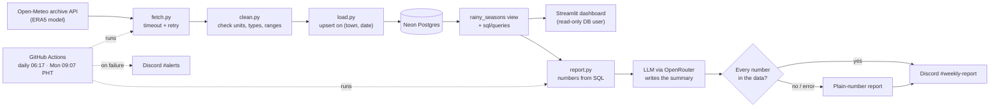

# Laguna Weather Pipeline

**Is the rainy season in Laguna, Philippines, shifting?** This project collects 35+ years of daily
weather for five Laguna towns, keeps it updated automatically, and answers that question with SQL.

**Live dashboard:** https://laguna-weather.streamlit.app/

## The answer (1991–2025)

| | Result | Verdict |
|---|---|---|
| **Season timing** | Onset averages **22 May**, trend −0.7 days/decade (95% range −6.3 to +4.9). End averages **31 Oct**, trend +6.0 days/decade (−3.2 to +15.2). | **No clear shift** |
| **December–January rain** | **+25% per decade**: +59 mm/decade on a 235 mm average (95% range +14 to +104). Clear in all 4 grid cells; the outlier-resistant Sen's slope agrees. | **Increasing** |
| **Annual rain** | **+6% per decade**: +143 mm/decade on a 2,368 mm average (95% range +12 to +273). Clear in 3 of 4 grid cells; San Pablo is borderline. | **Increasing** |

**In one line:** the rainy season isn't moving, but there is more rain, especially in December and
January after the main season.

Figures are averaged over the four distinct grid cells. "Clear" means the 95% range excludes zero.
Sources: [`season_trend.sql`](sql/queries/season_trend.sql) and [`rain_trend.sql`](sql/queries/rain_trend.sql).

## How it works



- **Daily (06:17 PHT):** run the tests, then fetch the last 14 days for every town, validate them,
  and upsert them into Postgres.
- **Weekly (Monday 09:07 PHT):** SQL computes each town's numbers for the latest complete week
  (vs the week before and vs the 1991–2020 normal). An LLM turns them into a short summary. The
  summary is checked against the numbers and posted to Discord, or a plain-number report goes out
  instead.
- **Dashboard:** reads the same SQL queries as the analysis, so the page and the findings can't disagree.

## Design decisions

**One weather model for every year.** Open-Meteo's default data switches from the ERA5 model to
ECMWF IFS in 2017. I compared San Pablo's annual totals for 2014–2020: they matched ERA5 exactly
until 2016 and IFS from 2017, and IFS gave up to ~270 mm/year more rain. That switch would show up as
a fake "wetter since 2017" trend, so every year uses ERA5 (`WEATHER_MODEL` in
[`config.py`](pipeline/config.py)). The cost is a coarser grid (~25 km) and data that's ~5–7 days old.

**Season dates from each town's own average, not fixed thresholds.** I first applied PAGASA's
official onset rule (25 mm over 5 days, with 3 consecutive wet days). Checked against PAGASA's
declared dates for 2016–2024, it fired a median **28 days early**. The model data has too much light
drizzle: 28% of days in February and March count as "wet" (≥ 1 mm). I switched to the
anomalous-accumulation method (Liebmann & Marengo, 2001). It compares each day's rain with the town's
own average, so a constant bias cancels out. It lands a median **6 days before** PAGASA (64% within
±10 days, [`onset_vs_pagasa.sql`](sql/queries/onset_vs_pagasa.sql)). The rejected rule is kept, with
its numbers, in [`rainy_season_onset.sql`](sql/queries/rainy_season_onset.sql).

**A 30-year baseline.** Data starts in 1991, so the 1991–2020 WMO climate normals period is covered.
Ten years can't separate a real trend from El Niño and La Niña swings.

**Trends with uncertainty, not just slopes.** Every trend has a 95% confidence interval, plus Sen's
slope as a check that one extreme year isn't driving it. Neighbouring towns aren't treated as
independent evidence, and the two towns sharing a grid cell are counted once.

**Every job can be re-run safely.** Rows are upserted on their natural key `(location_id, date)`.
Schema files are numbered and idempotent. The daily job re-fetches 14 days, which covers ERA5's
delay, its revisions, and runs that start late. Recovering from any failure means running the job
again.

**Validate at the boundary; missing means NULL, never 0.** Structural problems (a missing variable,
changed units) stop the job: 86 °F would pass a °C range check, so the units themselves are checked.
A single impossible value is stored as NULL and logged with the reason. Database `CHECK` constraints
are a second line of defence.

**The LLM writes; SQL calculates.** The model only receives numbers computed in SQL, including the
differences and percentages, so it never does arithmetic. Its output is rejected if any number isn't
in the data (rounding allowed), a town is missing, the length is off, or it contains a link or
@mention. Several free models are tried in order, and if all fail, a plain-number report is posted.
Reports are saved before posting and marked as posted afterwards, so a re-run never posts twice.

**Least privilege.** The public dashboard connects as a Postgres user that can only `SELECT`. GitHub
Actions tokens are read-only, except for the keepalive job, which needs to push.

**Fail loudly.** Any failure gives a non-zero exit code and a Discord alert. The alert is sent with
`curl`, so it works even when Python or the dependencies are broken. A "fire drill" option fails on
purpose to test it.

**Keepalive.** GitHub disables scheduled workflows after 60 days without commits. A monthly job
pushes an empty commit only if the repo has been quiet for 25+ days (25 + 31 = 56 < 60).

**Analysis logic in SQL, defined once.** Season detection is a database view (`rainy_seasons`) used by
the analysis, the dashboard and the trend queries. Window functions and the regressions run in
Postgres; Python only orchestrates.

## Limits

- **Model data, not rain gauges.** ERA5 is a reanalysis: a weather model's reconstruction of past
  weather from observations, on a ~25 km grid. The five towns fall in four grid cells, and Calamba
  and Los Baños get identical rain.
- **Recent days arrive late.** ERA5 publishes ~5–7 days behind, so the weekly report covers the latest
  complete week, usually 8–14 days earlier.
- **35 years is short for climate.** The trends describe what happened since 1991. They don't explain
  why, and they don't predict.
- **The season search windows are my own choice** (±60 days around the typical onset; the end must
  come after the onset), not taken from a paper.
- **The PAGASA comparison is approximate.** PAGASA declares one national date (7 of 13 stations plus
  wind direction); ours are per-town model dates.
- **LLM checks cover numbers and town names, not wording.** A model could still write "more" where it
  should say "less", or spell a number out in words. The table shown above every summary lets
  readers check.

## Tech stack

Python 3.13 · requests · pandas · psycopg 3 (raw SQL, no ORM) · Neon Postgres · GitHub Actions ·
OpenRouter (free models) · Discord webhooks · Streamlit + Altair on Streamlit Community Cloud · pytest

## Setup (Windows / PowerShell)

Requires Python 3.13 and a Postgres database (this project uses a free Neon instance).

```powershell
py -3.13 -m venv .venv
.venv\Scripts\Activate.ps1
pip install -r requirements.txt
python -m pipeline.init_db   # creates tables and views, seeds the 5 towns; safe to re-run
```

### Environment variables

Put these in a `.env` file at the repo root for local runs (it's gitignored). In GitHub Actions,
set them as repository secrets. On Streamlit Cloud, set `DATABASE_URL` in the app's secrets.

| Variable | Used by | What it is |
|---|---|---|
| `DATABASE_URL` | all jobs, dashboard | Postgres connection string (`postgresql://...?sslmode=require`). The dashboard uses a read-only user. |
| `DISCORD_WEBHOOK_URL` | failure alerts | Discord webhook for the alerts channel |
| `DISCORD_REPORT_WEBHOOK_URL` | weekly report | Discord webhook for the `#weekly-report` channel |
| `OPENROUTER_API_KEY` | weekly report | OpenRouter API key; if it's missing, the plain-number report is sent |

## Running it

```powershell
python -m pipeline.ingest              # daily run: re-fetch the last 14 days
python -m pipeline.ingest --backfill   # full history since 1991 (~65k rows, a few minutes)
python -m pipeline.ingest --start 2020-01-01 --end 2020-12-31   # any range

python -m pipeline.report --dry-run    # weekly report: print it; don't save or post
python -m pipeline.report              # latest complete week; skips weeks already posted

streamlit run dashboard/app.py         # dashboard at http://localhost:8501
pytest                                 # all tests
```

Every command is safe to re-run.

### Automation (GitHub Actions)

| Workflow | When | What it does |
|---|---|---|
| [`daily.yml`](.github/workflows/daily.yml) | every day, 06:17 PHT | tests, then `pipeline.ingest`; Discord alert on failure |
| [`weekly.yml`](.github/workflows/weekly.yml) | Mondays, 09:07 PHT | tests, then `pipeline.report`; skips weeks already posted |
| [`keepalive.yml`](.github/workflows/keepalive.yml) | 1st of each month | empty commit if the repo has been quiet for 25+ days |

All three can be started by hand from the Actions tab. `daily.yml` and `weekly.yml` have a
**fire drill** option that fails on purpose to test the alert.

## Tests

`pytest` runs 36 tests, with no network or database needed:
- **[`test_clean.py`](tests/test_clean.py):** bad values become NULL and are reported, missing stays
  missing, and structural problems (units, missing fields, bad dates) stop the job.
- **[`test_ingest.py`](tests/test_ingest.py):** date chunking, NaN → NULL, and a regression test for an
  ERA5 quirk that once let empty days into the table.
- **[`test_report.py`](tests/test_report.py):** the LLM safeguards. Made-up numbers, the model's own
  arithmetic, missing towns, empty answers, links and @mentions are all rejected.

## Project structure

```
pipeline/            config, fetch → clean → load, ingest (orchestration), report, db helper, init_db
sql/                 001_schema.sql, 002_views.sql (rainy_seasons), 003_reports_posted.sql
sql/queries/         one file per question: monthly rain, rolling rain, seasons, trends, weekly summary
dashboard/app.py     Streamlit dashboard
tests/               pytest suite
.github/workflows/   daily, weekly, keepalive
PLAN.md              roadmap and phase status
```
